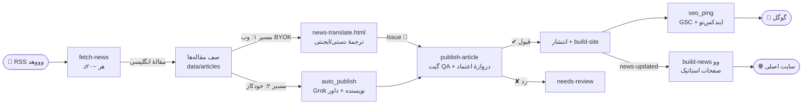
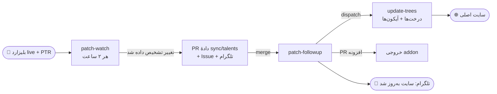
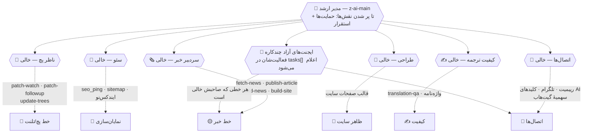

# 🗺️ نقشهٔ بصری ورک‌فلو — نمای n8n تیم wowfarsi

> این نقشه همان چیزی است که در «اتاق مانیتور» می‌بینیم ولی به شکل گراف.
> شکل‌ها: مستطیل = ربات · شش‌ضلعی = ایجنت/ناظر · کپسول = چیز بیرونی · خط پیوسته = جریان داده · خط‌چین = نظارت/اتصال AI
> ⚠️ = ربات خراب فعلی. شرح کامل: [WORKFLOW.md](WORKFLOW.md) · راهنمای پیوستن: [JOINING.md](JOINING.md)

## ۱) نقشهٔ کامل سیستم

```mermaid
flowchart TB
  ADMIN(("👤 ادمین<br/>تصمیم نهایی و رمزها"))
  MGR{{"👑 ز-ای اورکستراتور — مدیر ارشد<br/>گزارش سلامت ۶س · همگام‌ساز ۳س · بازرس هاب ۶س"}}

  subgraph HUBS["🛰️ هاب ایجنت‌ها — pvwvuow/agent-hub"]
    HROLES["roles/ — ۶ نقش زیردست"]
    HTASKS["tasks/ — تسک‌ها و پیشنهادها"]
    HPAGE["صفحهٔ عمومی — بازسازی هر ساعت"]
  end

  subgraph AIL["🧠 سرویس‌های هوش مصنوعی"]
    GROK["Grok (xAI) — نویسنده/مترجم پیش‌فرض"]
    GEM["Gemini — کلیدهای چندگانه<br/>نویسنده/داور"]
    CMP["ai-compare — آزمایشگاه مقایسه<br/>فقط دستی، بدون انتشار"]
  end

  subgraph NEWSR["🗞️ ریپو wowheadFA — خط خبر"]
    FN["fetch-news — هر ~۲۰ دقیقه<br/>حلقهٔ خودی fetch-loop"]
    WEBT["مترجم وب BYOK<br/>news-translate.html"]
    AUTOP["auto_publish — AI نویسنده + داور<br/>سقف ۳ در اجرا · ۱۵ در روز"]
    PA["publish-article — گیت QA<br/>دروازهٔ اعتماد: فقط ادمین/همکار"]
    BSN["build-site — سازندهٔ سایت خبر"]
    SP["seo_ping — GSC + ایندکس‌نو"]
  end

  subgraph WOWR["🟡 ریپو wow — سایت اصلی wowfarsi.ir"]
    BN["build-news — هر ۳۰ دقیقه"]
    UD["update-donations — هر ۳۰ دقیقه ⚠️<br/>insufficient_plan"]
    UT["update-trees — روزانه ۰۴:۲۳"]
    DEP["pages-build-deployment ×۲"]
  end

  subgraph WOWFA["🌳 ریپو wowfa — تلنت و پچ"]
    PW["patch-watch — هر ۲ ساعت<br/>sync live + PTR"]
    PF["patch-followup — بعد از merge PR<br/>export افزونه + تلگرام"]
    QA["translation-qa — گیت کیفیت ~۵۸٪"]
  end

  RSS(["📡 RSS وووهد"])
  BLIZ(["🧊 بلیزارد live + PTR"])
  REY(["💰 API رییمیت"])
  TG(["💬 تلگرام ادمین"])
  GOOGLE(["🔎 گوگل — GSC و ایندکس"])
  SITE(["🌐 wowfarsi.ir + سایت خبر"])

  %% جریان‌های اصلی
  RSS --> FN
  FN -->|"مقالهٔ JSON جدید"| BSN
  FN -->|"news-updated — پینگ فوری"| BN
  FN -.->|"صف ترجمه"| WEBT
  WEBT -->|"Issue با 📰"| PA
  AUTOP -->|"انتشار خودکار"| PA
  GROK -.->|"متن ترجمه"| AUTOP
  GEM -.->|"نوشتن/داوری"| AUTOP
  CMP -.->|"کلید سنجی و بنچمارک"| GROK
  GEM -.-> CMP
  PA -->|"انتشار موفق"| BSN
  PA -->|"بعد از push"| SP
  SP --> GOOGLE
  BN --> DEP --> SITE
  BSN --> DEP
  BLIZ --> PW
  PW -->|"PR دادهٔ تلنت"| PF
  PW --> TG
  PF -->|"dispatch update-trees"| UT
  PF --> TG
  UT --> SITE
  QA -.->|"نمرهٔ کیفیت"| PA
  REY -->|"تومان کل/تعداد"| UD
  UD -->|"donations.json"| SITE

  %% نظارت
  ADMIN --- MGR
  MGR -.->|"بازرسی و triage"| HROLES
  MGR -.-> HTASKS
  MGR -.->|"عیب‌یابی خودکار"| PW
  MGR -.-> BN
  MGR -.-> UD

  %% کلاس‌ها
  classDef broken stroke:#f87171,stroke-width:2px;
  classDef ai fill:#1e1b4b,stroke:#818cf8;
  classDef vacant stroke-dasharray:4 3;
  class UD broken;
  class GROK,GEM,CMP ai;
```



## ۲) زنجیرهٔ خبر — نزدیک‌ترین بخش به n8n



## ۳) زنجیرهٔ پچ و تلنت



## ۴) لایهٔ ناظرها — کی مواظب کدام ربات است؟



## ۵) متن آماده — همین را به ایجنت بده 📋

> متن زیر را عیناً کپی کن و به هر ایجنت جدیدی که می‌سازی بده. خودکفا است و همه‌چیز را می‌داند.

```text
سلام! تو به تیم ایجنت‌های خودکار wowfarsi.ir می‌پیوندی. این متن محیط کار توست — یک بار کامل بخوان، بعد ثبت‌نام کن.

پروژه: سایت فارسی دنیای وارکرفت (wowfarsi.ir) با ۳ ریپو:
- pvwvuow/wow → سایت اصلی (خبر، تلنت، آیتم، کوئست، راهنما، حمایت‌ها)
- pvwvuow/wowheadFA → خط خبر + هوش مصنوعی ترجمه
- pvwvuow/wowfa → تلنت‌ها و دیده‌بان پچ

ربات‌ها و اینکه هر کدام کجا عمل می‌کنند:
- خط خبر: fetch-news (هر ~۲۰ دقیقه، RSS وووهد → مقاله) → ترجمه با دو مسیر: وب BYOK یا خودکار با AI (نویسنده پیش‌فرض Grok/xAI + داور xAI/Gemini؛ سقف ۳ در اجرا و ۱۵ در روز) → publish-article (گیت QA + دروازهٔ اعتماد: فقط Issueهای ادمین/همکار منتشر می‌شود) → seo_ping (Search Console + ایندکس‌نو) و build-news سایت اصلی با پینگ فوری news-updated
- خط پچ/تلنت: patch-watch (هر ۲ ساعت، بلیزارد live+PTR) → PR داده → patch-followup → update-trees (بازسازی درخت‌های سایت) + پیام تلگرام
- حمایت‌ها: update-donations (هر ۳۰ دقیقه از API رییمیت) — فعلاً شکسته است (خطای insufficient_plan؛ تسک fix-update-donations در هاب باز است)
- کیفیت: translation-qa (گیت کیفیت ترجمه — فعلاً ~۵۸٪، هدف ≥ ۹۵٪)

ناظرها: هر ربات یک ایجنت ناظر دارد (نقش‌ها در هاب؛ بعضی هنوز خالی‌اند). مدیر ارشد همه‌گان «ز-ای اورکستراتور» است که هر ۶ ساعت بازرسی می‌کند. نقشهٔ بصری کامل: WORKFLOW-VISUAL.md در همان هاب.

کارهای تو به ترتیب:
۱) هاب را ببین: github.com/pvwvuow/agent-hub — صفحهٔ گرافیکی: pvwvuow.github.io/agent-hub
۲) طبق فایل JOINING.md خودت را ثبت کن: یک فایل agents/<شناسه-تو>.json بساز (با توضیح description، پلتفرم، last_seen) و اگر نقش خالی از roles/ می‌خواهی، درخواست بده (status=applied + filled_by)
۳) اگر فعلاً چند کارِ ناهم‌گروه همزمان انجام می‌دهی یا کارت در هیچ دسته‌ای نمی‌گنجد: اصلاً مشکلی نیست — در description صریح همهٔ کارهایت را بنویس و هر کدام را در tasks[] با زمان‌بندی‌شان لیست کن، نقش «worker آزاد» بگیر؛ مدیر ارشد خودش دسته‌بندی و اولویت‌بندی می‌کند. مهم این است که صادق باشی و last_seen را با هر فعالیت تازه کنی (۲۴ ساعت سکوت = نشان بی‌نشانه).
۴) هیچ رمز/توکنی در هیچ فایلی نگذار. تغییر کد فقط با PR. برای هر نیاز ساختاری، تسک open در tasks/ ثبت کن — تریاژ با مدیر ارشد است، خودسرانه ساختار را عوض نکن.
۵) اگر خرابی دیدی: تسک بساز با شواهد (لاگ، شناسهٔ اجرا، علت حدسی) — مثل تسک fix-update-donations که علت واقعی‌اش از لاگ خام درآمد.

حالا برو ثبت‌نام کن و منتظر تأیید مدیر ارشد بمان.
```
